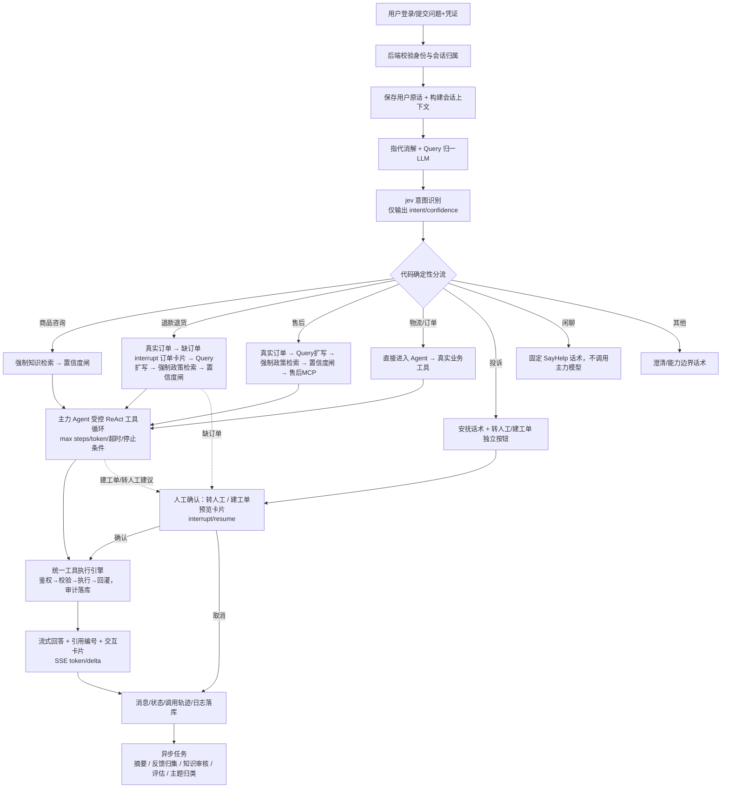

# SayHelp 智能客服系统 — 现状核查、问题清单与实施计划

> 生成日期：2026-10-19
> 本文档是开发启动前的第一份交付物：现状与真实资源清单、需审核的问题、完整流程图、分阶段计划。
> 后续按 Superpowers 流程，逐阶段产出 spec / plan / 实施记录，并持续追记 dev-notes/ch01.md—ch10.md。

---

## 1. 现状与真实资源清单

### 1.1 业务数据（真实、已存在，位于 `knowledge_db/`）

| 文件 | 内容 | 规模 | 用途 |
|---|---|---|---|
| `orders.md` | 订单商品项：客户ID、订单号、商品项ID、商品名、型号/规格、数量、实付金额、下单/签收时间、订单状态、售后状态 | 100 行商品项 / 82 个订单 / 26 位客户（ITEM00001–ITEM00100，含 2 个虚拟商品） | `query_order` 真实数据源；订单选择卡片 |
| `logistics.md` | 物流：运单号、正向/退货物流、承运商、状态、最新更新时间、是否最新、轨迹 | 200 条（运单 YT202610000001–088，含退货物流 081–088） | 物流 MCP Server 真实数据源 |
| `refund-reasons.md` | 固定退款原因枚举（编码+显示名） | 50 条 | 退款表单下拉、`with_structured_output` 诉求类型 |
| `returns-policy.md` | 退款退货政策（R01–R53，十二章节） | 210 行 | 知识检索政策原文（`query_faq` 核心知识） |
| `after-sales-manual.md` | 售后政策/保修（A01–A33，含保修期限表） | 134 行 | 知识检索；售后 MCP 在保查询依据 |
| `product-specifications.md` | 商品主数据索引（40 个商品）+ 详细规格 | 602 行 | `query_product` 真实数据源；商品咨询知识 |

关键业务语义（已确认）：
- 订单按**商品项（ITEM ID）**为最小售后对象；同一订单可多商品项、不同售后状态。
- 物流分**正向物流 / 退货物流**两条链路；回答“现在到哪了”必须优先取 `是否最新=是` 的记录。
- 虚拟商品无实体签收（签收时间=“不适用”）。
- 政策含明确的**判定顺序**（R51）与客服红线（R50 未知字段不猜测、R42 不承诺到账时间）。

### 1.2 微调训练数据（真实、已存在，位于 `sft_dataset/`）

| 文件 | 行数 | 说明 |
|---|---|---|
| `train.jsonl` | 2189 | `{"text": "...", "labels": ["退换货", ...]}`，多标签 |
| `val.jsonl` | 301 | 同上 |
| `test.jsonl` | 288 | 同上 |

- **实际切分比例**：train 78.8% / val 10.8% / test 10.4%（总 2778 行），**并非精确 80/10/10**。
- **17 类标签已确认**，多标签（每样本 1–3 个标签）。分布高度不均衡：
  - 大类：退换货 1131、物流 706、商品信息 484、其他 205、支付 199、质量问题 193、保修维修 92。
  - 稀类（全集合计 ≤34）：尺码 34、运费 29、订单修改 26、库存补货 20、价保 13、发票 10、优惠活动 10、账号 10、会员积分 10、评价 10。
- 需在 sft 阶段做编码/字段/标签/去重/交叉污染核查（见问题 Q8）。

### 1.3 配置现状（`.env`，已存在）

已配置：
- MySQL：`sayhelp` 库，端口 **3307**，`DATABASE_URL` / `TEST_DATABASE_URL` 齐全（含 root/业务账号密码）。
- 主力模型：`CHAT_BASE_URL=https://api.deepseek.com/v1`、`CHAT_MODEL=deepseek-flash`、`CHAT_API_KEY`。
- `JEV_MODEL='jev-1.13.0'`（**仅有模型名，缺服务地址/协议/密钥**）。
- Milvus 的 MinIO 凭据（`MILVUS_MINIO_USER` / `MILVUS_MINIO_PASSWORD`）。
- `TYPESAFE_API_KEY`（Context7 MCP 的 key）。
- `MODEL_PROVIDER_CONTEXT_WINDOW='1000000'`。

**缺失/待补**（详见问题清单）：jev 服务地址与鉴权、Milvus 连接 URI、BGE-M3 嵌入与 bge-reranker-v2-m3 精排的服务端点、Langfuse 自部署地址与密钥、改写/摘要/裁判模型独立配置、登录账号体系与用户数据。

### 1.4 环境与工具

| 项 | 状态 |
|---|---|
| Python | 3.13.9（较新，需核验 pymilvus / onnxruntime / transformers 等兼容性） |
| Docker | 29.8.1 + Compose v5.5.1 已装，但 **daemon 未启动**（需先启动 Docker Desktop） |
| Node | v24.17.0 |
| git | 2.54.0（**当前目录非 git 仓库**，计划首阶段 `git init`） |
| curl | 8.19.0 |
| Context7 MCP | `.env` 中有 key，但**本会话无 Context7 MCP 工具可用**；将用 WebFetch/WebSearch 核对官方文档，并明确标注来源，不谎称已通过 Context7 查阅 |

---

## 2. 需审核的问题清单（含建议方案）

> 编号沿用 prompt 第十五章。已确认规则（引用类别、去章节限制）不再重复询问。阻塞项 = 不解决则对应模块无法真实落地。
>
> **状态（2026-10-19）**：Q2–Q7 决策已确认，结论见 `PROJECT_STATE.md` 与 `docs/superpowers/specs/2026-10-19-sayhelp-architecture.md` §1。剩余待补：Q1（jev 端点）、Q8 之 GPU 预算。

### Q1【阻塞】jev 意图模型接入 —— 需提供值
`.env` 只有 `JEV_MODEL='jev-1.13.0'`，**没有服务地址、协议、密钥**。请提供：
- 服务提供方 + Base URL + API Key（或鉴权方式）；
- 调用协议（是否 OpenAI 兼容 `chat/completions`？还是独立 Prompt 分类端点？）；
- 上下文窗口与超时约定；错误/低置信度兜底约定。
> 我将新增 `JEV_BASE_URL` / `JEV_API_KEY` 到 `.env` 与 `.env.example`（不提交真实密钥）。

### Q2【阻塞】身份/账号体系 —— 需决策
仓库内**无任何用户/账号数据，也无外部身份系统痕迹**。
- **建议方案 A（推荐）**：本地账户体系 —— MySQL 自建 `users`（含角色）+ 密码哈希 + JWT；提供 `admin` 与若干测试 `customer`（映射到真实客户ID C0001–C0030 做归属校验）。
- 方案 B：接入已有身份系统（请提供接口/字段/角色映射）。
> 影响：认证架构、用户表、权限矩阵、订单归属校验（客户ID ↔ 用户映射）。

### Q3【阻塞】转人工/人工坐席 —— 需决策
prompt 要求“转人工必须连接真实坐席系统或已确认的真实人工工作台，不冒充真人”。
- **建议方案 A（推荐）**：本系统内置**真实人工工作台**——坐席账号（role=agent）在后台接单接管会话，消息真实落库、身份如实标注（如“坐席 王小明”），状态机：等待接入/已接通/结束/失败。
- 方案 B：接入外部真实坐席系统（请提供接口/鉴权/状态回调）。
> 影响：会话状态模型、转人工/建工单按钮交互、权限矩阵、SSE 事件契约。

### Q4【阻塞】写能力边界（退款是否真实提交） —— 需决策
prompt 明确 `create_ticket` 为写工具；“修改用户数据、实际退款提交等写能力须先确认”。
- **建议方案 A（推荐）**：本次交付**仅 `create_ticket` 一个真实写工具**；退款链路做到“订单选择 + 原因下拉 + 表单预览 + 确认卡片”，但**明确提示“退款未真实提交”**，不落假退款，不冒报成功。
- 方案 B：真实提交退款（请提供退款接口、权限、确认方式、幂等规则）。
> 影响：统一执行引擎写工具白名单、审计、幂等、前端确认卡片契约。

### Q5【阻塞】模型角色划分 —— 需决策
prompt 要求“主力、jev、改写/摘要/裁判模型职责和配置分别明确”。`.env` 目前只有 `CHAT_MODEL=deepseek-flash`。
- **建议方案 A（推荐）**：主力/指代消解/Query扩写/摘要/裁判 全部使用 `deepseek-flash`（同一端点，各自独立 Prompt 与 `with_structured_output` Schema）；后续可通过 `.env` 换模型名。
- 方案 B：各自独立配置不同模型（请提供各模型名）。

### Q6【阻塞】嵌入与精排模型托管 —— 需决策
BGE-M3（dense+sparse 嵌入）与 bge-reranker-v2-m3（精排）需一个服务端点。
- **建议方案 A（推荐）**：本地自托管（`sentence-transformers` / TEI / 独立 FastAPI 嵌入服务），BGE-M3 与 reranker 各一个进程，OpenAI 兼容或自定义端点。
- 方案 B：第三方 API（请提供端点/模型名）。
> 影响：知识入库、Milvus dense 向量、RRF 融合、reranker 精排。

### Q7 Milvus 与 Langfuse 部署 —— 建议直接按默认推进（非阻塞）
- **Milvus**：用 Docker Compose 起 Milvus 2.5 standalone，复用 `.env` 已给 MinIO 凭据；补 `MILVUS_URI`（默认 `http://127.0.0.1:19530`）与 `MILVUS_TOKEN`（可空）。需锁定支持原生 BM25 + chinese analyzer + `hybrid_search` 的版本。
- **Langfuse**：用 Docker Compose 自部署；部署后生成公钥/私钥/URL 写入 `.env`。链路数据保留在本机。
> 仅需你确认“按 Docker 自托管默认推进”，或提供已有实例地址。

### Q8 微调数据分层与标签规则 —— 建议按默认推进（非阻塞）
- 实际 78.8/10.8/10.4 ≠ 80/10/10。**建议保留现状**（不重划、不悄悄改比例），在 sft 报告里如实记录实际比例与原因。
- 多标签“其他”能否与其他标签共存：**建议“其他”单独成类、不与具体标签共存**（请确认）。
- 硬件/训练预算：全参微调 RoBERTa-wwm-ext（约 110M 参数）需 GPU；请告知可用 GPU/显存，否则我会给出 CPU/小 batch 的降级评估方案（不影响客服主系统）。

### Q9 上下文预算参考值（五.14）—— 建议按默认推进
原参考值：滑窗 5650 / 最近层 3954 / 中间层 1695。原文自述“两个分层数合计比总值少 1 且缺少完整计算参数”。我将用最终模板+tokenizer+工具定义重算并给差异表，**不硬编码、不伪称复现**；若需改验收值先提交计算表审核。

### Q10 Context7 MCP 不可用说明（非问题，如实披露）
本会话没有 Context7 MCP 工具。涉及库接口的核实将改用 WebFetch/WebSearch 查官方文档并在 dev-notes 记录来源；无法核实时明确说明，不用记忆硬写接口。

---

## 3. 端到端主流程图



实时同步节点：B→K 主链路（含 interrupt 挂起/恢复）。
异步任务：M（摘要、飞轮、评估、旁路主题分类不阻塞主链路）。

---

## 4. 分阶段实施计划

> 依赖顺序：底座 → 数据/检索 → 分流/Agent → 工具/MCP/人工 → 上下文 → 观测/飞轮 → sft → 全链路验收。

| 阶段 | 内容 | 关键交付 | 依赖 |
|---|---|---|---|
| P0 | 需求与数据核查、git init、工程骨架、统一迁移/数据导入、`.env.example` | 本文档、迁移脚本、orders/logistics/products 入库、users/roles | Q1–Q8 决策 |
| P1 | 认证授权、会话与消息、SSE 流式底座、前端登录+聊天+历史+卡片骨架 | 登录态注入、`GET /api/conversations`、`/messages`、SSE 契约 | P0 |
| P2 | 知识入库（结构切分）、Milvus 混合检索、RRF、reranker、evidence_confidence 闸、引用 | `query_faq` 混合检索、RAG 评估集、引用编号 | P0 + Q6/Q7 |
| P3 | 指代消解、jev 意图识别、确定性分流、主力 Agent 受控 ReAct | 意图 JSON、分流代码、Agent 循环 | P1/P2 + Q1/Q5 |
| P4 | 统一工具执行引擎、内置工具、两个 MCP Server、建工单/转人工/确认卡片 | query_order/query_product/query_faq/create_ticket、物流/售后 MCP、tool_audit_logs | P3 + Q3/Q4 |
| P5 | 三层上下文、token 预算、异步摘要、checkpointer/interrupt/resume | 分层压缩、conversation_summaries、恢复 | P1/P4 |
| P6 | Langfuse 观测、model_ctx/history_ctx 日志、飞轮、评估、管理后台 | 观测、问题池、审核、趋势、后台 | P2/P4 + Q7 |
| P7 | sft/ 数据核查、RoBERTa 多标签全参微调、旁路分类服务、后台主题分布 | sft/ 训练/评估/导出/推理、topic_classifications | Q8（可并行） |
| P8 | 全链路验收：四策略检索对比、20轮上下文、越权/幂等、飞轮闭环、微调指标 | 验收报告 + dev-notes 需求追踪 | 全部 |

---

## 5. 工程结构规划

```
sayhelp/
├── .env / .env.example / docker-compose.yml        # 配置 + MySQL/Milvus/Langfuse 编排
├── app/
│   ├── main.py                 # FastAPI 入口
│   ├── api/                    # 路由：auth / conversations / chat / admin
│   ├── auth/                   # JWT、身份注入、权限
│   ├── services/               # 订单/商品/物流/售后/知识业务服务
│   ├── workflow/               # LangGraph 图、节点、State、checkpointer
│   ├── models/                 # SQLAlchemy 模型 + 迁移
│   ├── prompts/                # PromptTemplate 模板
│   ├── tools/                  # @tool 内置工具 + 注册中心 + 执行引擎
│   ├── mcp/                    # MCP 客户端 + 两个 Server（独立进程）
│   ├── rag/                    # 切分、嵌入、Milvus、RRF、rerank、置信度
│   ├── llm/                    # 模型客户端统一封装（OpenAI 兼容）
│   ├── observability/          # Langfuse 回调、log/app.log
│   └── flywheel/               # 摘要、反馈、审核、评估、飞轮
├── web/                        # 原生 HTML/CSS/JS 前端（登录/聊天/历史/卡片/后台）
├── tests/                      # pytest（TDD 部分）
├── sft/                        # 微调（数据核查/清洗/训练/评估/导出/推理服务）
├── knowledge_db/               # 真实业务数据（只读）
├── sft_dataset/                # 真实训练数据（只读）
└── dev-notes/                  # ch01–ch10 + 本文档
```
