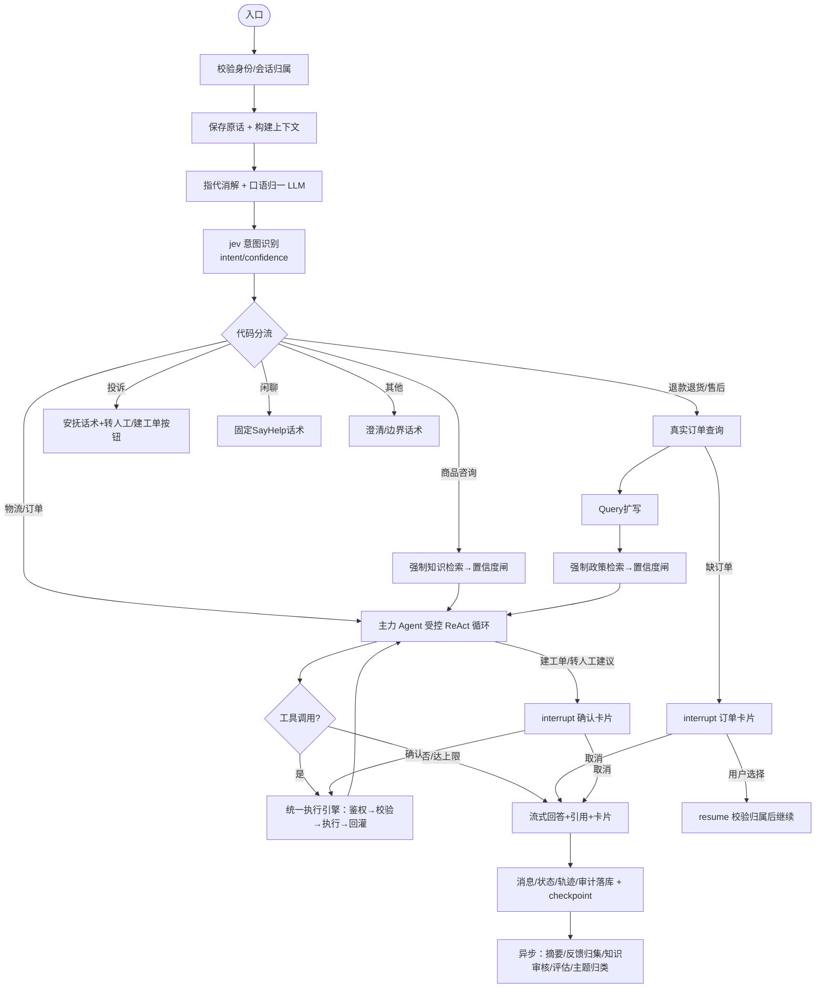

# SayHelp 智能客服系统 — 架构契约（Spec）

> 状态：待用户审阅
> 日期：2026-10-19
> 本文整合 prompt.txt 最终需求、真实数据（knowledge_db/、sft_dataset/）与已确认的 8 项决策，作为实施计划与验收的唯一架构依据。与 prompt 冲突处以本文 + 用户后续纠偏为准。

---

## 1. 已锁定决策（2026-10-19 确认）

| # | 决策点 | 结论 |
|---|---|---|
| D1 | 身份/账号体系 | 本地账户 + JWT；MySQL 自建 `users`/`roles`，密码哈希；admin + 测试 customer 映射到真实客户ID（C0001–C0030）做归属校验 |
| D2 | 转人工 | 内置真实人工工作台；坐席账号（role=agent）后台接单接管会话，身份如实展示，状态机 等待接入/已接通/结束/失败 |
| D3 | 写能力边界 | 仅 `create_ticket` 为真实写工具；退款链路=订单选择+原因下拉+表单预览+确认卡片，明确提示「退款未真实提交」，不冒报成功 |
| D4 | 模型角色 | 主力/指代消解/Query扩写/摘要/裁判 统一 `deepseek-flash`（各自独立 Prompt 与 Schema）；jev 独立 |
| D5 | 嵌入/精排 | 本地自托管：BGE-M3（dense+sparse）与 bge-reranker-v2-m3 各一个服务进程 |
| D6 | 训练切分 | 保留现状 78.8/10.8/10.4%，sft 报告如实记录 |
| D7 | 「其他」标签 | 单独成类，不与具体标签共存 |
| D8 | Milvus/Langfuse | Docker 自托管（Milvus 2.5 standalone 复用已给 MinIO 凭据；Langfuse 自部署） |

**待补配置（阻塞对应模块，不阻塞整体推进）**：
- **jev**（阻塞 P3 意图节点）：`JEV_BASE_URL` / `JEV_API_KEY` / 协议 / 上下文窗口。`.env` 现有 `JEV_MODEL='jev-1.13.0'`。
- **GPU 预算**（阻塞 P7 sft 训练；不阻塞客服主系统）。

---

## 2. 系统架构总览

```
┌─────────────── 浏览器（原生 HTML/CSS/JS）───────────────┐
│ 登录页 │ 聊天页（气泡/工具徽章/引用卡片/👍👎/返回最新）│ 历史侧栏 │ 管理后台 │
└──────────────────────────┬──────────────────────────────┘
                           │ HTTPS/JSON + SSE
┌──────────────────────────▼──────────────────────────────┐
│ FastAPI 应用层（app/）                                    │
│  api/  auth/(JWT+身份注入)  services/  workflow/(LangGraph)│
│  llm/(OpenAI兼容客户端)  rag/  tools/(注册+执行引擎)       │
│  mcp/(client)  observability/(Langfuse+log)  flywheel/    │
└──────┬──────────┬──────────┬──────────┬──────────────────┘
       │          │          │          │
   MySQL(权威存储) Milvus 2.5   Langfuse   log/app.log
   业务/消息/知识   dense+BM25   自部署     上下文日志
   审计/飞轮      +RRF+rerank
       │
   ┌───┴──────────────┐
   │ MCP Servers(独立进程)│
   │ 物流Server 售后Server │
   │ (Streamable HTTP)   │
   └────────────────────┘
   嵌入服务(BGE-M3) 精排服务(reranker)  jev意图(待配置)  deepseek(主力)
```

**职责边界**：
- MySQL = 权威存储（业务数据、消息原文、知识原文、审核/审计）。
- Milvus = 检索索引（MySQL `knowledge_chunks` 为原文权威源，Milvus `knowledge` 为索引）。
- LangGraph `checkpointer` = 图运行状态（持久化/恢复）；消息历史 = MySQL（原文/查询）。二者不互相替代。
- 工具结果：完整/限额结果存 `tool_audit_logs` + checkpoint，`messages` 保留 `tool_call_id` 引用 + 一行可追溯标识；模型上下文按预算裁剪（见 §7）。

---

## 3. 数据模型（MySQL，InnoDB + utf8mb4）

> 附录 A 的 DDL 语义（唯一约束、外键删除语义、索引、枚举、默认值）全部保留；新增表/字段按需补齐。迁移用统一工具（Alembic）按依赖顺序执行。

### 3.1 身份与权限
```sql
CREATE TABLE users (
  id            BIGINT UNSIGNED NOT NULL AUTO_INCREMENT,
  username      VARCHAR(64)  NOT NULL,
  password_hash VARCHAR(255) NOT NULL,               -- bcrypt
  role          ENUM('customer','agent','admin') NOT NULL DEFAULT 'customer',
  customer_id   VARCHAR(16)  NULL,                   -- 映射真实客户ID C0001..；customer 角色必填
  display_name  VARCHAR(64)  NULL,                   -- 坐席真实姓名，转人工时如实展示
  is_active     TINYINT(1)   NOT NULL DEFAULT 1,
  created_at    DATETIME NOT NULL DEFAULT CURRENT_TIMESTAMP,
  PRIMARY KEY (id), UNIQUE KEY uk_username (username),
  KEY idx_customer_id (customer_id)
) ENGINE=InnoDB DEFAULT CHARSET=utf8mb4;
```

### 3.2 业务数据（从真实文件导入）
```sql
CREATE TABLE orders (               -- orders.md
  id BIGINT UNSIGNED NOT NULL AUTO_INCREMENT,
  customer_id  VARCHAR(16) NOT NULL,
  order_no     VARCHAR(32) NOT NULL,
  item_id      VARCHAR(32) NOT NULL,
  product_name VARCHAR(128) NOT NULL,
  model_spec   VARCHAR(128) NULL,
  quantity     INT NOT NULL DEFAULT 1,
  paid_amount  DECIMAL(10,2) NOT NULL,
  order_time   DATETIME NOT NULL,
  sign_time    DATETIME NULL,       -- 虚拟商品为 NULL（“不适用”）
  order_status VARCHAR(32) NOT NULL,
  after_sale_status VARCHAR(32) NOT NULL DEFAULT '无售后',
  PRIMARY KEY (id),
  UNIQUE KEY uk_item (item_id),
  KEY idx_customer (customer_id), KEY idx_order (order_no)
) ENGINE=InnoDB DEFAULT CHARSET=utf8mb4;

CREATE TABLE products (             -- product-specifications.md 主数据索引
  id BIGINT UNSIGNED NOT NULL AUTO_INCREMENT,
  product_name VARCHAR(128) NOT NULL,
  model        VARCHAR(64) NOT NULL,
  order_spec   VARCHAR(128) NOT NULL,
  product_type VARCHAR(64) NOT NULL,
  seven_day_return VARCHAR(128) NOT NULL,   -- 七天无理由属性
  warranty     VARCHAR(128) NOT NULL,       -- 保修/售后属性
  PRIMARY KEY (id), UNIQUE KEY uk_model (model), KEY idx_name (product_name)
) ENGINE=InnoDB DEFAULT CHARSET=utf8mb4;

CREATE TABLE logistics (            -- logistics.md；每条运单多个历史快照
  id BIGINT UNSIGNED NOT NULL AUTO_INCREMENT,
  order_no     VARCHAR(32) NOT NULL,
  item_ids     VARCHAR(128) NOT NULL,
  waybill_no   VARCHAR(32) NOT NULL,
  logistics_type VARCHAR(16) NOT NULL,   -- 正向物流/退货物流
  carrier      VARCHAR(32) NOT NULL,
  status       VARCHAR(32) NOT NULL,
  latest_time  DATETIME NOT NULL,
  is_latest    TINYINT(1) NOT NULL DEFAULT 1,
  trajectory   TEXT NOT NULL,
  PRIMARY KEY (id),
  KEY idx_order (order_no), KEY idx_waybill (waybill_no), KEY idx_latest (is_latest)
) ENGINE=InnoDB DEFAULT CHARSET=utf8mb4;

CREATE TABLE refund_reasons (       -- refund-reasons.md
  code VARCHAR(64) NOT NULL, display_name VARCHAR(64) NOT NULL,
  PRIMARY KEY (code)
) ENGINE=InnoDB DEFAULT CHARSET=utf8mb4;
```

### 3.3 会话与消息
```sql
CREATE TABLE conversations (
  id BIGINT UNSIGNED NOT NULL AUTO_INCREMENT,
  user_id BIGINT UNSIGNED NOT NULL,
  status VARCHAR(32) NOT NULL DEFAULT 'open',     -- open / agent_waiting / agent_connected / ended
  summary TEXT NULL,                              -- 分段摘要投影
  summary_upto_msg_id BIGINT UNSIGNED NULL,
  layer1_from_msg_id BIGINT UNSIGNED NULL,
  created_at DATETIME NOT NULL DEFAULT CURRENT_TIMESTAMP,
  updated_at DATETIME NOT NULL DEFAULT CURRENT_TIMESTAMP ON UPDATE CURRENT_TIMESTAMP,
  PRIMARY KEY (id), KEY idx_user (user_id)
) ENGINE=InnoDB DEFAULT CHARSET=utf8mb4;

CREATE TABLE messages (
  id BIGINT UNSIGNED NOT NULL AUTO_INCREMENT,
  conversation_id BIGINT UNSIGNED NOT NULL,
  role ENUM('user','assistant','tool','system') NOT NULL,
  content TEXT NOT NULL,
  tool_call_id VARCHAR(64) NULL,                  -- 对回 tool_audit_logs / 工具调用
  tool_calls JSON NULL,                           -- 助手提出的工具调用申请（名称+参数，脱敏后）
  citations JSON NULL,                            -- 回答引用编号映射 [{n,type,ref,chunk_id/query_id}]
  feedback JSON NULL,                             -- {type:'up'|'down', at}，幂等单值
  created_at DATETIME NOT NULL DEFAULT CURRENT_TIMESTAMP,
  PRIMARY KEY (id), KEY idx_conv (conversation_id, id)
) ENGINE=InnoDB DEFAULT CHARSET=utf8mb4;

CREATE TABLE retrieval_snapshots (  -- 每轮检索证据快照（👎 回捞依据；区分「未检索」与「快照丢失」）
  id BIGINT UNSIGNED NOT NULL AUTO_INCREMENT,
  conversation_id BIGINT UNSIGNED NOT NULL,
  user_message_id BIGINT UNSIGNED NOT NULL,       -- 当轮用户问题
  answer_message_id BIGINT UNSIGNED NULL,         -- 当轮回答（未生成时为 NULL）
  evidence JSON NULL,                             -- Top-K 全集 + 得分 + 编号
  evidence_confidence DECIMAL(5,4) NULL,
  created_at DATETIME NOT NULL DEFAULT CURRENT_TIMESTAMP,
  PRIMARY KEY (id), KEY idx_conv_msg (conversation_id, user_message_id)
) ENGINE=InnoDB DEFAULT CHARSET=utf8mb4;
```

### 3.4 知识库
```sql
-- 附录A 原文 + 补来源元数据
CREATE TABLE knowledge_chunks (
  id BIGINT UNSIGNED NOT NULL AUTO_INCREMENT,
  category VARCHAR(255) NOT NULL,
  questions TEXT NOT NULL,
  answer TEXT NOT NULL,
  section_path VARCHAR(512) NULL,
  content_type VARCHAR(32) NULL,                  -- faq/policy/manual
  is_key_clause TINYINT(1) NOT NULL DEFAULT 0,
  prev_chunk_id BIGINT UNSIGNED NULL,
  next_chunk_id BIGINT UNSIGNED NULL,
  vector_id VARCHAR(64) NULL,
  vectorize_status ENUM('pending','done') NOT NULL DEFAULT 'pending',
  doc_id VARCHAR(64) NULL, doc_version VARCHAR(32) NULL, doc_source VARCHAR(255) NULL,
  created_at DATETIME NOT NULL DEFAULT CURRENT_TIMESTAMP,
  updated_at DATETIME NOT NULL DEFAULT CURRENT_TIMESTAMP ON UPDATE CURRENT_TIMESTAMP,
  PRIMARY KEY (id), KEY idx_category (category), KEY idx_vectorize_status (vectorize_status),
  CONSTRAINT fk_chunks_prev FOREIGN KEY (prev_chunk_id) REFERENCES knowledge_chunks(id) ON DELETE SET NULL,
  CONSTRAINT fk_chunks_next FOREIGN KEY (next_chunk_id) REFERENCES knowledge_chunks(id) ON DELETE SET NULL
) ENGINE=InnoDB DEFAULT CHARSET=utf8mb4;

CREATE TABLE qa_extraction_staging (
  id BIGINT UNSIGNED NOT NULL AUTO_INCREMENT,
  batch_no VARCHAR(64) NOT NULL, source_ref VARCHAR(255) NULL,
  question TEXT NOT NULL, answer TEXT NOT NULL,
  status ENUM('extracted','kept','discarded') NOT NULL DEFAULT 'extracted',
  created_at DATETIME NOT NULL DEFAULT CURRENT_TIMESTAMP,
  PRIMARY KEY (id), KEY idx_batch_no (batch_no), KEY idx_status (status)
) ENGINE=InnoDB DEFAULT CHARSET=utf8mb4;

CREATE TABLE conversation_summaries (
  id BIGINT UNSIGNED NOT NULL AUTO_INCREMENT,
  conversation_id BIGINT UNSIGNED NOT NULL,
  seq INT NOT NULL,
  from_msg_id BIGINT UNSIGNED NOT NULL, upto_msg_id BIGINT UNSIGNED NOT NULL,
  content TEXT NOT NULL,
  created_at DATETIME NOT NULL DEFAULT CURRENT_TIMESTAMP,
  PRIMARY KEY (id), UNIQUE KEY uk_conv_seq (conversation_id, seq),
  KEY idx_conv_upto (conversation_id, upto_msg_id)
) ENGINE=InnoDB DEFAULT CHARSET=utf8mb4;
```

### 3.5 工单、审计、飞轮、评估
```sql
CREATE TABLE tickets (
  ticket_no VARCHAR(32) NOT NULL,                 -- 真实工单号主键
  conversation_id BIGINT UNSIGNED NOT NULL,
  description TEXT NOT NULL,
  type VARCHAR(32) NOT NULL,
  status VARCHAR(32) NOT NULL DEFAULT 'open',
  idempotency_key VARCHAR(64) NOT NULL,           -- 幂等：确认卡片 + 会话 + 参数指纹
  created_at DATETIME NOT NULL DEFAULT CURRENT_TIMESTAMP,
  PRIMARY KEY (ticket_no), UNIQUE KEY uk_idem (idempotency_key)
) ENGINE=InnoDB DEFAULT CHARSET=utf8mb4;

CREATE TABLE tool_audit_logs (                     -- 附录A 原文，不挂外键
  id BIGINT UNSIGNED NOT NULL AUTO_INCREMENT,
  conversation_id BIGINT UNSIGNED NULL,
  tool_call_id VARCHAR(64) NULL, tool_name VARCHAR(128) NOT NULL,
  tool_source ENUM('builtin','mcp') NOT NULL, mcp_server VARCHAR(64) NULL,
  arguments JSON NULL, result_summary TEXT NULL,
  status ENUM('成功','失败','超时','校验拦下','权限拒绝') NOT NULL,
  error_message VARCHAR(512) NULL,
  retry_count TINYINT UNSIGNED NOT NULL DEFAULT 0,
  duration_ms INT UNSIGNED NULL,
  created_at DATETIME NOT NULL DEFAULT CURRENT_TIMESTAMP,
  PRIMARY KEY (id), KEY idx_conversation_id (conversation_id),
  KEY idx_tool_name (tool_name), KEY idx_status (status)
) ENGINE=InnoDB DEFAULT CHARSET=utf8mb4;

CREATE TABLE low_confidence_questions (
  id BIGINT UNSIGNED NOT NULL AUTO_INCREMENT,
  conversation_id BIGINT UNSIGNED NULL,
  raw_question TEXT NOT NULL,
  source ENUM('retrieval_low_conf','self_check','user_feedback') NOT NULL,
  reason TEXT NULL,
  retrieved_chunks JSON NULL,
  matched_review_id BIGINT UNSIGNED NULL,
  created_at DATETIME NOT NULL DEFAULT CURRENT_TIMESTAMP,
  PRIMARY KEY (id), KEY idx_source (source), KEY idx_created_at (created_at),
  KEY idx_matched_review_id (matched_review_id),
  CONSTRAINT fk_lcq_conversation FOREIGN KEY (conversation_id) REFERENCES conversations(id),
  CONSTRAINT fk_lcq_review FOREIGN KEY (matched_review_id) REFERENCES review_queue(id) ON DELETE SET NULL
) ENGINE=InnoDB DEFAULT CHARSET=utf8mb4;

CREATE TABLE review_queue (
  id BIGINT UNSIGNED NOT NULL AUTO_INCREMENT,
  normalized_question VARCHAR(512) NOT NULL,
  ai_suggested_answer TEXT NULL,
  occurrence_count INT UNSIGNED NOT NULL DEFAULT 1,
  review_status ENUM('待审','通过','驳回') NOT NULL DEFAULT '待审',
  approved_answer TEXT NULL,
  created_at DATETIME NOT NULL DEFAULT CURRENT_TIMESTAMP,
  updated_at DATETIME NOT NULL DEFAULT CURRENT_TIMESTAMP ON UPDATE CURRENT_TIMESTAMP,
  PRIMARY KEY (id), KEY idx_review_status (review_status)
) ENGINE=InnoDB DEFAULT CHARSET=utf8mb4;

CREATE TABLE faith_cases (                          -- 附录A 原文
  id BIGINT UNSIGNED NOT NULL AUTO_INCREMENT,
  eval_id VARCHAR(16) NOT NULL, bucket VARCHAR(24) NOT NULL,
  query VARCHAR(512) NOT NULL, strategy VARCHAR(24) NOT NULL DEFAULT 'hybrid_rerank',
  answer TEXT NOT NULL, reason TEXT NOT NULL, citations JSON NULL,
  judge_model VARCHAR(64) NULL,
  status ENUM('未解决','已解决','无需解决') NOT NULL DEFAULT '未解决',
  seen_count INT UNSIGNED NOT NULL DEFAULT 1,
  first_seen_at DATETIME NOT NULL DEFAULT CURRENT_TIMESTAMP,
  last_seen_at DATETIME NOT NULL DEFAULT CURRENT_TIMESTAMP,
  resolution VARCHAR(300) NULL, resolved_at DATETIME NULL,
  PRIMARY KEY (id), UNIQUE KEY uk_eval_id (eval_id),
  KEY idx_status (status), KEY idx_last_seen_at (last_seen_at)
) ENGINE=InnoDB DEFAULT CHARSET=utf8mb4;

CREATE TABLE eval_runs (
  id BIGINT UNSIGNED NOT NULL AUTO_INCREMENT,
  triggered_by ENUM('定时','手动') NOT NULL DEFAULT '定时',
  dataset_size INT UNSIGNED NOT NULL,
  eval_set VARCHAR(64) NULL, config_json JSON NULL, model_version VARCHAR(64) NULL,
  metrics JSON NOT NULL,
  created_at DATETIME NOT NULL DEFAULT CURRENT_TIMESTAMP,
  PRIMARY KEY (id), KEY idx_created_at (created_at)
) ENGINE=InnoDB DEFAULT CHARSET=utf8mb4;

CREATE TABLE topic_classifications (
  id BIGINT UNSIGNED NOT NULL AUTO_INCREMENT,
  low_confidence_question_id BIGINT UNSIGNED NOT NULL,
  labels JSON NOT NULL,                            -- 多标签数组
  classified_at DATETIME NOT NULL DEFAULT CURRENT_TIMESTAMP,
  model_version VARCHAR(64) NULL,
  PRIMARY KEY (id), KEY idx_lcq (low_confidence_question_id)
) ENGINE=InnoDB DEFAULT CHARSET=utf8mb4;
```

**建表依赖顺序**：users → conversations → (messages / tickets / retrieval_snapshots) → knowledge_chunks → qa_extraction_staging → conversation_summaries → review_queue → low_confidence_questions（依赖 review_queue）→ tool_audit_logs（无外键）→ faith_cases → eval_runs → topic_classifications → 业务表（orders/products/logistics/refund_reasons）。

---

## 4. 核心契约

### 4.1 意图识别（jev，独立于主力模型）
```json
{"intent": "退款退货", "confidence": 0.93}
```
- 枚举：`物流 / 订单 / 商品咨询 / 退款退货 / 售后 / 投诉 / 闲聊 / 其他`。
- 只输出 `intent`、`confidence` 两字段；结构错误/超时/低置信度（< 阈值）→ 兜底「其他」并记录，不强塞类别。
- 分类置信度（`intent_confidence`）与检索 `evidence_confidence` 分开存储、校准。

### 4.2 结构化输出（with_structured_output）
- 售后提取：`{order_no, demand_type, expected_solution, ...}` 缺失项显式空/待补充。
- Query 扩写：`{"queries": [...]}`（仅退款退货/售后检索场景）。
- 生成侧自评：`{"useful": true/false, "reason": "..."}`；`useful=false` → 拒答入池（source=self_check）。

### 4.3 分流规则（代码确定性，不靠模型）
| 意图 | 子流程 |
|---|---|
| 商品咨询 | 强制知识检索 → evidence_confidence 闸 → Agent |
| 退款退货 | 真实订单 →（缺订单则 interrupt 订单卡片）→ Query 扩写 → 强制政策检索 → 置信度闸 → Agent |
| 售后 | 真实订单 → Query 扩写 → 强制政策检索 → 置信度闸 → Agent（业务查询走售后 MCP） |
| 物流/订单 | 直接 Agent，真实业务工具查询（无检索置信度闸） |
| 投诉 | 安抚话术 + 独立「转人工」「建工单」按钮，不进主力 Agent，不自动执行 |
| 闲聊 | 固定 SayHelp 话术，不调用主力生成模型（分类调用仍计入 token 统计） |
| 其他 | 澄清/能力边界话术 |

### 4.4 内置工具（LangChain @tool）与 MCP
- 内置：`query_order`、`query_product`、`query_faq`、`create_ticket`（写）。
- MCP 物流 Server：`query_logistics`（物流轨迹）。
- MCP 售后 Server：`query_warranty`（在保查询）、`query_return_progress`（退货进度）。
- 旧内置 `query_logistics` 退出注册，避免重名。
- 注册中心：工具名/描述/JSON Schema/来源/本地权限规则；MCP 工具动态发现，每轮取清单；Server 新增工具重启后可重新发现，客服服务不重启。

### 4.5 隐藏身份注入
- 身份（user_id、token、权限）由后端引擎注入工具执行上下文，**不出现在**模型可见的工具参数 Schema、System Prompt、模型消息、工具结果。
- 工具可见性（模型能否看到）与执行权限（引擎是否放行）分离；每轮/resume 重新鉴权。
- 认证上下文与模型上下文分离；内置工具与 MCP 边界均白名单 + 脱敏。

### 4.6 API 与 SSE 契约（要点）
- `POST /api/auth/login` → JWT；`GET /api/auth/me`。
- `POST /api/chat/stream`（SSE）：事件类型约定
  - `text`（token/delta 增量，逐字）、`status`（工具执行/检索/中断等待）、`reference`（引用）、`card`（交互卡片：订单选择/建工单预览）、`error`、`done`。
- `GET /api/conversations`、`GET /api/conversations/{id}/messages`（分页 + 归属校验）。
- 交互卡片：`card` 事件携带 `interrupt_id`；`POST /api/chat/resume`（订单选择 / 确认建工单 / 取消），服务端校验归属 + 幂等 + 防跨会话 resume。
- 反馈：`POST /api/messages/{id}/feedback`（👍/👎，幂等）。
- 管理后台：`/api/admin/*`（仅 admin，模型调用历史、工具审计、知识审核、低置信度、评估趋势、faith_cases、主题分布）。

---

## 5. LangGraph 工作流（确定性 + 受控 Agent）



- `State.messages` 用 `add_messages` reducer，各节点返回新增消息；完整历史随 checkpoint 保存。
- 调用模型前另建精简上下文（`trim_messages` + 分层规则 + token 预算），**不改原始历史**。
- 主力 Agent：最大步数/总 token 预算/超时/重复无效调用检测/停止条件，达到上限可理解收敛。
- 先手写最小工具循环验证，再 LangGraph 重构（保留最小示例 + 前后对应说明，生产统一走 LangGraph）。

---

## 6. 知识入库与混合检索

- **切分**：标题结构感知；超长段递归切分；块间重叠裁到最近句号；无句号超长文本/大表按行拆分并复制表头。
- **向量化文本** = `category + questions + answer` 拼接；FAQ/QA 用真实问法，政策用章节标题作 questions，上级标题路径作 category。
- **双写**：先写 MySQL（pending）→ Milvus upsert（稳定主键）→ 回填 vector_id + done；中断/重跑/并发不重复。
- **检索**：dense（BGE-M3）+ BM25（Milvus 原生，chinese analyzer）各 Top-50 → `hybrid_search` + RRF 融合 → bge-reranker-v2-m3 精排 Top-10。
- **evidence_confidence 闸**：综合精排 Top1 相关性 + 有效证据数量 + Top1/Top2 分差；阈值用标注集校准。不足 → 拒答入池（`retrieval_low_conf`）。
- **引用**：回答内 `[1] [2]` → 回答后来源列表，编号映射到本轮证据快照/chunk/章节路径/文档版本；业务回答附查询记录编号；无依据话术注明「无外部文献」。

---

## 7. 上下文三层结构（当前会话）

- **最近层**（`id > layer1_from_msg_id`）：原文。
- **中间层**（`summary_upto_msg_id < id ≤ layer1_from_msg_id`）：用户原话不动，客服回复留开头几十字，大块工具结果压成一行可追溯标识。
- **已摘要区**（`id ≤ summary_upto_msg_id`）：异步摘要独立存 `conversation_summaries`，只追加。
- 中间层超 **token 预算**才触发异步摘要（非消息条数）；触发时固定本批边界，成功后 `summary_upto_msg_id` 追到该批 `layer1_from_msg_id`，不覆盖并发新消息；不阻塞当前回复。
- 预算从窗口倒推，扣除 system/工具定义/证据/摘要/输出预留/安全余量；历史预算=期望轮数预算与实际剩余取小，最近层 70% / 中间层 30%，整数取整规则在计划中明确。
- 模型上下文顺序：system 人设/红线/工具定义 → 中间层精简 → 最近层原文 → 当前问题 → 早期摘要+检索证据合为**一条标注的上下文消息**（不伪装成用户指令）。

---

## 8. 飞轮、观测与后台

- **观测**：Langfuse 自部署，在 LangGraph 图层统一挂接一次回调（版本兼容性用 WebFetch 核实后记录于 dev-notes）；记录每节点模型输入输出、检索、工具、tokens、耗时、错误、意图元数据。认证凭证不入 trace。
- **上下文日志**：每轮调用前写 `log/app.log` 的 `model_ctx`（摘要全文/滑窗/条数/token 估算）与 `history_ctx`（摘要行+滑窗消息，闲聊轮也记录）；发送前日志与实际输入一致。
- **问题池三入口**：`retrieval_low_conf` / `self_check` / `user_feedback`（👎）。👎 回捞**原轮次**证据快照（区分「未检索」与「快照丢失」）。
- **飞轮**：原话标准化 → AI 示例答案（仅供审核）→ 语义查重（LLM 判定，非字符串相等）→ 合并/新建 `review_queue` → 人工审核（填写核准答案/驳回理由）→ 核准走统一入库 → 更新可见 → 回归评估。
- **后台**（仅 admin）：模型调用历史、工具审计、知识审核、低置信度详情、评估趋势、faith_cases、主题分布（标注多标签统计口径）。

---

## 9. 模块边界与目录（见 00 文档 §5）

---

## 10. 阻塞项与风险

| 项 | 状态 | 影响 |
|---|---|---|
| jev 端点/协议/密钥 | 待用户提供 | P3 意图节点无法真实接线（可先按 OpenAI 兼容协议实现 + `.env` 占位） |
| Docker daemon 未启动 | 需用户启动 Docker Desktop | MySQL/Milvus/Langfuse 无法起 |
| Python 3.13 兼容性 | 实施中核验 | pymilvus/onnxruntime/transformers 版本选择 |
| GPU 预算 | 待提供 | P7 sft 全参训练可行性（可降级 CPU） |
| Context7 MCP 不可用 | 用 WebFetch 替代 | 库接口需逐一查官方文档 |

---

## 11. 验收映射（需求 → 实现 → 验收）

需求追踪表 + ch01–ch10 的 41 条验收（附录 B）在 `dev-notes/ch01.md`—`ch10.md` 逐条映射；本文只锁定架构契约。**没有跑通的功能不标完成**。
